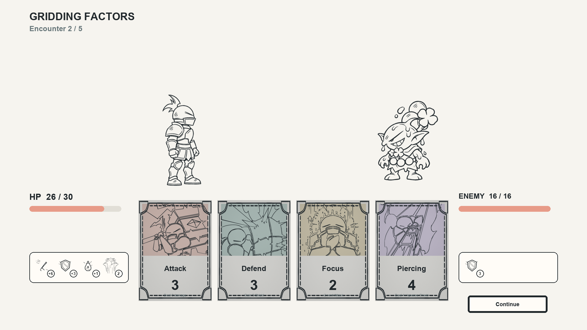

# Gridding Factors

**A hand-drawn bingo deckbuilder about turning lucky numbers into a build.**

Gridding Factors is a short run-based game built in Unity 6 for the Official Unity Game Jam 2026. The jam theme is **Lucky Numbers**. Instead of treating bingo as a side minigame, the board is the engine that powers the cards: every marked cell changes the next fight, and every completed line gives you an Ultimate.

## Jam theme: Lucky Numbers

The whole game is built around the question: *what makes a number lucky?*

- **The draw is luck.** Balls 1-75 are pulled at random. The same number can be a gift on one board and a dead draw on another.
- **The board interprets luck.** A cell might call a number lucky because it is even, prime, divisible by 4, greater than 45, or a wildcard. Luck is not one rule; it is the rule you chose to build around.
- **Lucky outcomes are earned.** Rerolls, wildcards, and the centre LUCKY cell let you bend probability, but they are limited resources.
- **The theme is in the fiction.** The first enemy is the Lucky Slime, the board is a fairground bingo machine, and the shop is a slightly shady stall where you buy better odds.
- **The payoff is a build.** Completed lines turn lucky placements into Ultimates, and the shop lets you upgrade the numbers and buffs you want to keep hitting.

No neon slot machines and no passive "luck stat" - the theme is expressed through numbers, odds, and the small thrill of a draw going your way.

## The idea

Most deckbuilders ask, "Which card do I add?" Gridding Factors also asks, "Which number can I afford to chase?"

- **Bingo is the build.** A 5x5 board of number rules (Even, Odd, Div 3, Prime, >45, Wild, and so on) sits beside the powerball draw. The number you draw decides which cells are playable.
- **Cells are buffs.** Marking a cell triggers its buff: extra attack, shield, healing, Focus, an extra card next round, or a wildcard.
- **Lines are Ultimates.** A completed row, column, or diagonal earns a combat Ultimate: attack multipliers, enemy-attack blocks, or card multipliers with healing.
- **Cards are the payoff.** The Bingo board feeds a small hand of Attack, Defend, Focus, Heal, and Piercing cards. The hand is capped at **4 cards**.
- **The shop shapes the board.** Between encounters you can buy a Heal or Piercing card, upgrade a Bingo condition, or upgrade a buff cell.
- **The run is five encounters.** Win the Bingo phase, survive the fight, spend coins, and go again. The final boss is the fifth encounter.

The visual direction is charcoal ink on warm ivory paper, with coral, teal, ochre, sage, and lavender accents. No neon, no glossy 3D, no baked-in text. The cards and characters are drawn like a small, slightly mischievous tabletop game.

## How a run works

### 1. Bingo phase

1. A powerball is drawn from a bag of numbers **1-75**.
2. Cells whose rule matches the number light up.
3. Click one highlighted cell to place the number and trigger its buff.
4. If the draw cannot be placed, use **Reroll** to draw a number that can be placed.
5. **Next Round** moves to combat. The board persists between encounters; the number bag resets each encounter.

Completing a line awards an Ultimate charge:

| Line | Ultimate |
|---|---|
| Horizontal | Next Attack deals multiplied damage |
| Vertical | Blocks one enemy attack |
| Diagonal | Next card is multiplied and heals |

### 2. Combat phase

- Play **one card**, then the enemy responds; press **Continue** to start the next round.
- **Attack** deals damage.
- **Defend** gains Shield.
- **Focus** adds damage to your next Attack. Focus is capped at **6**.
- **Heal** restores HP.
- **Piercing** is the Ultimate card: it ignores Shield and is marked as ULTIMATE.
- A combat hand contains at most **4 cards**. The base draw is 3; the U2 Bingo buff can add one more, up to 4.

### 3. Shop phase

After clearing encounters 1-4 you visit the shop:

| Offer | What it does | Price |
|---|---|---|
| Card | Adds Heal (first shop) or Piercing (later shops) | 10 first shop, 20 later |
| Upgrade Condition | Choose a Bingo cell and upgrade its condition (for example, to ANY) | 35 |
| Upgrade Buff | Choose a buff cell and increase its value | 20 |

Each offer can be bought once per shop visit. **Next Encounter** advances the run.

### Win / lose

- Clear all **5 encounters** to win.
- Reach **0 HP** and the run ends in defeat.
- The player starts at **30 HP** and **10 coins**.

## Controls

The game is mouse/touch only. There is no keyboard or controller gameplay yet.

| Screen | Action |
|---|---|
| Main menu | Click **PLAY** or **HOW TO PLAY** |
| Tutorial | Click **BACK**, **NEXT**, or **START** |
| Bingo | **Draw** to pull a ball; click a highlighted cell to place it; **Reroll** for a placeable ball; **Next Round** to enter combat |
| Combat | Click a card to play it; **Continue** to advance the round |
| Shop | **Buy** an offer, choose a target in the selector, then **Next Encounter** |
| Menus / selector | Click buttons and cells; no dragging required |

The game is designed for **1920x1080** and scales with screen size; **1280x720** is the low-end layout target.

## Collaborators

**Ang Weiyi - Main Artist & Game Tinker**
Ang owns the hand-drawn identity of Gridding Factors: the cards, characters, frames, shop, and the overall ink-on-paper look. He also contributes to the game's feel and rules - the "tinker" side of the project: what a card should feel like, what a buff should do, and how the board should read at a glance.

**Liu GuangXuan / LongMai - Programmer, Designer, Producer & Everything Else**
LongMai builds the systems, UI, combat loop, Bingo logic, shop, audio integration, builds, testing, and production. On a small team, "everything else" is the job description.

**The team** - playtesting, balance discussions, and the parts of game design that happen on a whiteboard or over a call.

## AI disclosure

We use AI as a production assistant, not as a replacement for the game's art identity.

- **Art:** Some placeholder character, enemy, and UI assets were generated with AI image tools and cleaned up locally. These are placeholders; Ang Weiyi will replace them with hand-drawn work as time allows. The owner-drawn cards, frames, and backgrounds remain the visual reference.
- **Code:** AI tools helped debug and review code. Every change is reviewed, compiled, and playtested by the developer.
- **Writing:** AI helped draft and edit this README and the roadmap.
- **Runtime:** There is no generative AI running in the game.

We will keep the AI disclosure visible on the project page and update it as placeholder assets are replaced.

## Current status

Gridding Factors is a **playable vertical slice**, not a finished commercial release.

- 5 encounters, a complete Bingo - Combat - Shop loop, win and defeat states.
- Hand-drawn card frames and Bingo cells; placeholder AI character/enemy art.
- Static characters and UI; no character animation yet.
- Temporary/placeholder audio mix.
- One enemy archetype with scaled stats and placeholder names.
- WebGL build target, 1920x1080 reference resolution.

Known gaps are tracked in the [roadmap](ROADMAP.md).

## Audio credits

- BGM: **"Lost in the forest" by TOOPS** - OpenGameArt.org, **CC-BY 4.0**. Attribution required.
- SFX: **Kenney Casino Audio** and **Kenney UI Audio** - CC0.
- **"Win sound effect" by Listener** - CC0.
- **"Bingo Machine Sound Effect"** - CC0.
- Defeat tone generated for this project.

See Assets/Resources/Audio/CREDITS.txt for source links.

## Build and run

1. Open the project in **Unity 6000.3.27f2** (Unity 6.3 LTS).
2. Open Assets/Scenes/GameScene.unity.
3. Press Play. The game starts at the main menu; **PLAY** opens the tutorial.
4. For the browser build, use the existing **Web** build profile / WebGL target.

The project uses Unity URP 2D and TextMeshPro. No additional packages are required for the current build.

## Roadmap

The full plan is in [ROADMAP.md](ROADMAP.md). In short:

1. Replace every placeholder and unanimated asset with Ang Weiyi's final art.
2. Animate characters, cards, the Bingo machine, and UI feedback.
3. Replace the temporary sound set and finish the mix.
4. Add real enemy archetypes and encounter identities.
5. Balance the economy, card values, buffs, and difficulty through playtests.
6. Improve accessibility, tooltips, save/continue, and platform polish.
